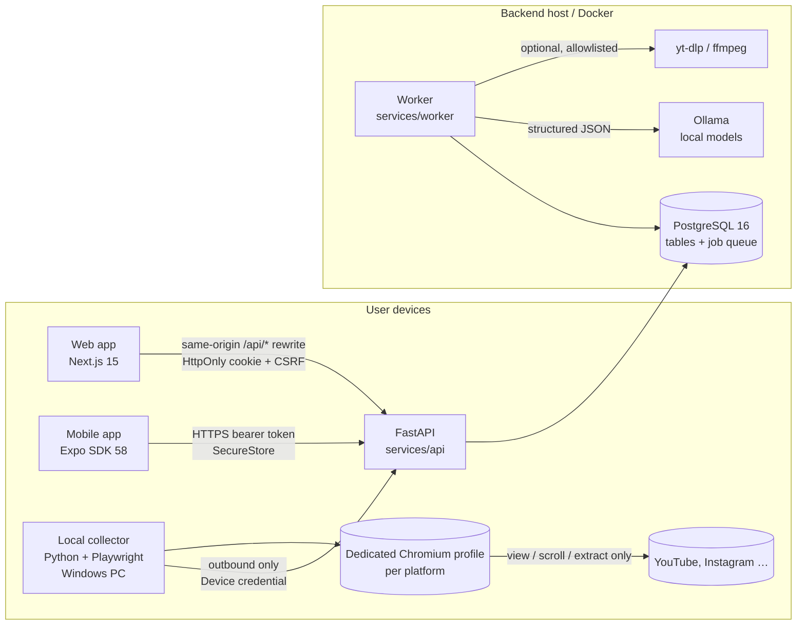
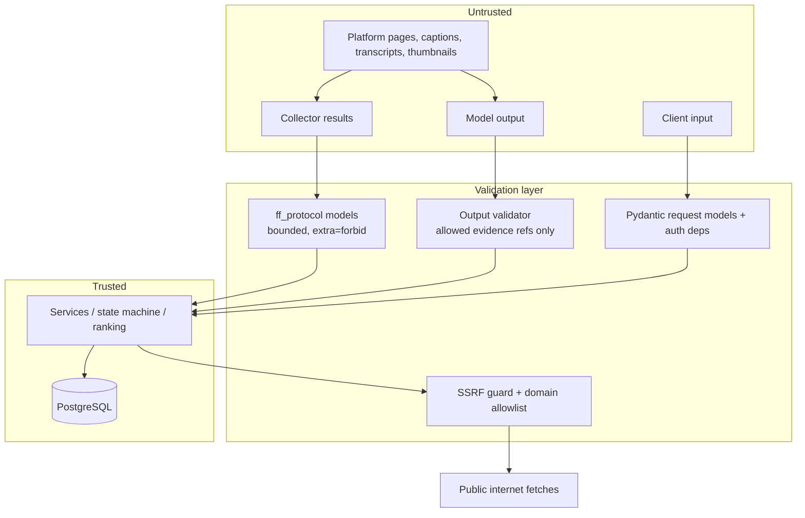

# Architecture

FocusFeed is one monorepo with a modular backend (not microservices), two
clients that share a generated contract, and a local collector that runs on
the user's own machine because personalized feeds only exist behind the user's
own login.

## Components

| Component | Path | Responsibility |
|---|---|---|
| Protocol | `packages/protocol` (`ff_protocol`) | Pydantic DTOs shared by API, worker and collector: job instruction, platform result, candidate + evidence contract, budgets, result states. |
| API | `services/api` (`focusfeed_api`) | Auth, preferences, platforms/connections, collector pairing + job protocol, jobs, batches, search, items/evidence, saved/feedback, schedules, models, privacy, health. Also hosts the ranking pipeline and providers (imported by the worker). |
| Worker | `services/worker` (`focusfeed_worker`) | Polls the PostgreSQL-backed queue (`SELECT … FOR UPDATE SKIP LOCKED`), runs the job state machine, in-process demo collection, evidence enrichment, ranking, schedules, lease expiry, retention cleanup. |
| Collector | `services/collector` (`focusfeed_collector`) | Windows-friendly CLI: pair, login, status, run, clear-session, revoke. Drives one persistent Chromium profile per platform with a domain allowlist and media blocking; executes typed job instructions; submits results idempotently. |
| Contracts | `packages/contracts` | `openapi.json` exported from FastAPI → `schema.d.ts` via openapi-typescript → `createApiClient` (openapi-fetch) used by both clients. CI fails on drift. |
| Web | `apps/web` | Welcome/login, onboarding, Today, Search, item detail, Saved, History, Schedules, Connect, Settings (models, privacy, sessions). |
| Mobile | `apps/mobile` | Native tabs Today/Search/Saved/Settings + login, onboarding, connect, item detail. Consumes results only; never runs the browser agent. |

## Data flow (daily batch)

1. User (web/mobile) `POST /api/v1/jobs` → `202 Accepted {job_id}`; the request never waits for browsing.
2. Worker claims the job (`queued`). In **demo/test** mode it runs the in-process `DemoAdapter`;
   in **live** mode it moves the job to `waiting_for_collector`.
3. The user's collector polls `POST /collector/jobs/claim` with its device credential, receives a
   `CollectorJobInstruction` (platforms, budget, checkpoints, allowed domains, lease token), scrolls
   a bounded number of steps per platform, posts progress/checkpoint events, renews its lease, and
   submits one `CollectorJobResult` (idempotency key).
4. The API ingests results: public catalog rows (`content_items`) upserted, private
   `user_observations` + owner-scoped `evidence_artifacts` inserted (idempotent). Job → `enriching`.
5. Worker: optional caption/frame enrichment (live only, tools enabled), then **ranking**:
   eligibility → dedup → bounded model enrichment (validated structured output) → scoring →
   MMR diversity + top-K + consumption budget → explanations. Exactly one
   `recommendation_batches` row per job (unique constraint) with ranked `recommendations`.
6. Clients read `GET /batches/today` (finite, ordered). Save/feedback/seen write back; feedback
   changes the next batch (tested) and hides items in the current one immediately.

## Trust boundaries

* Page content never reaches a shell, a prompt instruction slot, or a tool selector: it is data.
* Collector credentials are device-scoped: they can only heartbeat and work on the owner's jobs.
* The model sees minimized candidate JSON (title, caption, bounded transcript); never cookies,
  tokens, other users' data, or full browsing history.
* Local inference URL is administrator configuration; users select among approved models only.

## Database (summary)

Public catalog (`content_items`, `item_embeddings`) is separate from private data
(`user_observations`, `evidence_artifacts`, `recommendation_batches`, `recommendations`,
`saved_items`, `feedback`, `collection_jobs`, `job_events`, `schedules`, `collector_*`,
`platform_connections`, `preference_profiles`, `auth_sessions`). All private rows carry `user_id`
with FK cascade; uniqueness makes retries idempotent (`uq_batch_job`, `uq_observation_user_item_job`,
`uq_evidence_scope`, `uq_job_user_idempotency`). See `services/api/focusfeed_api/models.py` and the
Alembic migration under `services/api/alembic/versions/`.

## Failure handling

| Failure | Behaviour |
|---|---|
| Worker crash mid-job | Lease expires → another worker recovers (`lease_recovered` event), `attempts` increments, exponential backoff via `next_attempt_at`, `failed` after `max_attempts`. A re-run of the ranking stage finds the existing batch and does not create a second one. |
| Collector offline | Job waits in `waiting_for_collector` up to 15 min, then `failed` with an actionable reason; UI shows collector status and next step. |
| One platform fails | Per-platform states recorded; valid results from other platforms produce a `partial` batch with counts and reasons. |
| Login wall / challenge | Collector reports `needs_login` / `challenge_required`; job → `needs_user_action` with instructions; no retries, no bypass. |
| Model unavailable / invalid output | Bounded retry, then deterministic fallback labelled `analysis_source=unavailable`; the batch is still produced and the explanation says so. Never silently replaced by fixtures. |
| Cancellation | Checked before each platform, each media/model stage and in the collector loop; partial results are kept; state `cancelled`. |
| Account deletion during a job | Ownership re-check before any write; results refused; job cancelled. |
