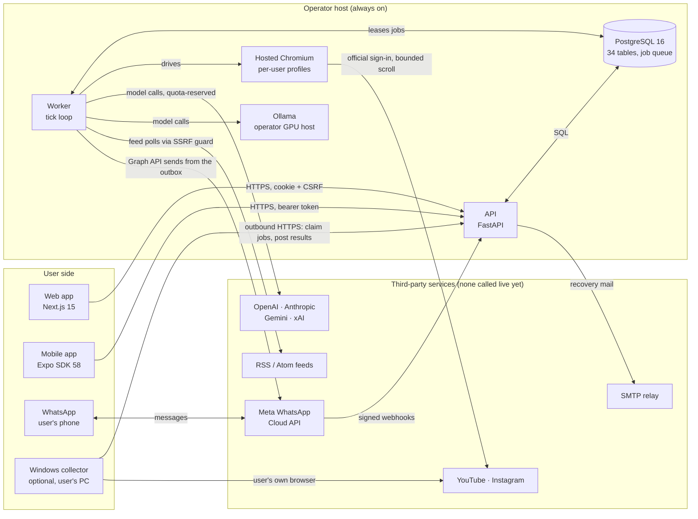

# FocusFeed handoff

Read this first if you are the next engineer or AI agent on this project. Then read `STATUS.md` and
`TASKS.md`. This file was written on 2026-11-09 by the AI session that built Phase 1 and Phase 2.

## Prompt to start the next session

```text
You are continuing the FocusFeed project in the GitHub repository mhmbnt1/SGP-AI-scroller.
Check out the branch feat/phase2-providers-hosted-whatsapp and read docs/HANDOFF.md first, then
STATUS.md and TASKS.md. Work on a new branch from there and never rewrite history. Do not claim
anything is live-verified unless you observed it against the real service, and do not spend money on
paid services without my explicit approval. Start with the first item under "Next actions" in
docs/HANDOFF.md.
```

## 1. What FocusFeed is

FocusFeed replaces open-ended scrolling with a finite, explained batch. It collects a bounded number
of items from the user's own feeds (YouTube/Shorts and Instagram Reels; TikTok, X and LinkedIn are
contract-only). It enriches and ranks them with an AI model against the user's stated interests and
delivers a short batch with a reason and sources for every pick. There is no autoplay and no infinite
scroll. Delivery is through the web app, the mobile app and, optionally, WhatsApp.

## 2. Where things are

| Item | State |
|---|---|
| `main` | Foundation commit only (`c11c3de`). Nothing has been merged. |
| `feat/focusfeed-foundation` → PR #1 (base `main`) | Phase 1, head `e8ffb58`, open. Every CI job fails because this branch's workflow pins GitHub Actions to commit SHAs that do not exist. The fix (version tags) is on the Phase 2 branch. |
| `feat/phase2-providers-hosted-whatsapp` → PR #2 (base `feat/focusfeed-foundation`) | Phase 2, open. CI observed 2026-11-09: Python ✓, web + contracts + mobile ✓, OpenAPI drift ✓, secret scan on push ✓, secret scan on pull_request ✗. |

The failing secret scan is a permission problem, not a leaked secret. The log says
`Resource not accessible by integration` from `gitleaks/gitleaks-action@v2`. The `security` job in
`.github/workflows/ci.yml` has `contents: read` and `security-events: write` but not
`pull-requests: read`, which the action needs to list a PR's commits.

Merging PR #2 into the Phase 1 branch first carries the CI fix into PR #1. Merge order is the
owner's decision.

PRs were created with the REST API because `gh` GraphQL was unavailable in the build sandbox:

```bash
gh api repos/mhmbnt1/SGP-AI-scroller/pulls --method POST --input pr.json
```

## 3. Architecture



How the pieces work together:

* **The API never does slow work in a request.** Requests write rows (jobs, connect-session inputs,
  inbox events). The worker picks them up on its tick. The queue is PostgreSQL itself (leases,
  attempts, backoff, idempotency keys); there is no Redis or broker.
* **Worker tick** (`services/worker/focusfeed_worker/orchestrator.py::tick`): due schedules become
  jobs, stale waits expire, connect sessions are driven, watches are polled and alerts queued, the
  WhatsApp inbox is processed and the outbox dispatched, reservations expire, then at most one job
  runs.
* **Job lifecycle** (`services/api/focusfeed_api/services/jobs.py`): `queued` → `collecting` (hosted,
  default) or `waiting_for_collector` → `collecting` (local PC) → `enriching` → `ranking` →
  `completed` or `partial`. Any active state can end in `cancelled`, `failed` or
  `needs_user_action`.
* **Ranking pipeline** (`services/api/focusfeed_api/pipeline/run.py`): intent, eligibility, dedup,
  capped enrichment with cited evidence, scoring, diverse selection (MMR, per-platform caps, time
  budget), then one explanation per pick. The batch is stored once per job.
* **Completion hooks**: a scheduled job's batch goes to the WhatsApp outbox when the user asked for
  that. A WhatsApp-originated job gets a reply with the ranked list and sources.
* **WhatsApp path**: Meta POSTs a signed webhook. The API checks the HMAC and size, then inserts
  deduplicated rows into `webhook_inbox` and returns 200. The worker's intent layer answers
  STOP/HELP/STATUS/LINK by rule, with no model call. Other text becomes a normal collection job.
  Replies go to `delivery_outbox`. `dispatch_due` checks opt-in, the 24-hour window and template
  rules right before sending through the Graph API. Status webhooks update outbox rows.

## 4. Repository map

| Path | What it is |
|---|---|
| `apps/web` | Next.js 15 web app. Routes: `/today`, `/search`, `/saved`, `/history`, `/history/[id]`, `/items/[id]`, `/schedules`, `/watches`, `/connect`, `/connect/[platform]`, `/settings`, `/onboarding`, `/recover`. Playwright e2e in `apps/web/e2e`. |
| `apps/mobile` | Expo SDK 58 app (expo-router). Tabs: today, search, saved, settings. Screens: ai, sources, connect-session, schedules, watches, whatsapp, recover, onboarding, connect, item. Jest tests in `apps/mobile/__tests__`. |
| `packages/contracts` | `openapi.json` exported from the API (77 paths) and the generated TypeScript client used by web and mobile. Never hand-edit `src/schema.d.ts`. |
| `packages/protocol` | `ff_protocol`: pydantic models shared by the API and the collector (job specs, budgets, results). |
| `services/api` | FastAPI app. `routers/` (20 modules), `services/` (business logic), `security/` (passwords, tokens, CSRF, SSRF guard, vault, rate limits), `providers/`, `pipeline/`, `channels/whatsapp.py`, Alembic migrations, tests, the `focusfeed-api` CLI. |
| `services/worker` | `focusfeed-worker`: tick loop, job orchestrator, hosted Chromium driver (`hosted.py`). |
| `services/collector` | Optional Windows collector CLI (`focusfeed-collector pair/login/run/clear-session`): pairing, keyring credential, Playwright profiles, domain allowlist, YouTube and Instagram adapters, contract-only TikTok/X/LinkedIn. |
| `scripts/` | `setup`, `migrate`, `seed`, `dev`, `test`, `e2e`, `preflight` as `.sh` and `.ps1`. |
| `docs/` | Design, security, threat model, acceptance matrices, setup guides, verification log. |
| `.claude/skills/` | Project skills: `ff-backend-change`, `ff-adapter-fixture`, `ff-security-review`. |
| `.github/workflows/ci.yml` | Python job, web + contracts + mobile job, OpenAPI drift check, secret and dependency scans. |
| `docker-compose.yml` | `db`, `api`, `worker`, `web`. Written but never run (no Docker daemon in the build sandbox). |

## 5. Delivered in Phase 1

* Auth with Argon2id passwords and opaque sessions: cookie + CSRF double-submit for web, bearer
  token in Keychain/Keystore (SecureStore) for mobile. Session list and revoke. Account deletion.
* Owner-scoped v1 API: preferences and onboarding, jobs, batches, items with evidence, saved items,
  feedback, search, schedules, collectors, platform connections, capabilities, models, privacy
  export/delete, health.
* PostgreSQL job queue with leases, attempts, backoff, cancel and idempotency keys. The worker state
  machine has bounded budgets per job.
* Ranking pipeline with an evaluation harness on synthetic labels (`reports/evaluation.json`).
* Fake provider for tests/demo and an Ollama provider with discovery, JSON-schema output, embeddings
  and a vision check.
* Local Windows collector with one-use pairing codes and an outbound-only protocol. YouTube and
  Instagram adapters are fixture-verified.
* DST-aware schedules, retention cleanup, SSRF guard, prompt-injection containment, audit trail
  without raw IPs or tokens.
* Web and mobile apps, CI workflow, Docker Compose file, docs set.

## 6. Delivered in Phase 2

* **AI providers**: OpenAI, Anthropic Claude, Google Gemini (google-genai), xAI Grok, service-hosted
  Ollama and the fake provider behind one normalized request/result type with structured JSON output
  (`providers/types.py`, `catalog.py`, `hosted.py`). Model ids and prices are catalog data, all marked
  `verified: false`. Auth, billing and policy errors are never retried. 429s and timeouts get bounded
  retries. A circuit breaker protects each provider.
* **Credentials and cost**: operator-managed consumer mode, where users never see keys. Per-user
  entitlements and row-locked quota reservations, with AI and messaging counted separately. A
  deployment-wide spend guard and price metadata with source and date; unknown costs are allowed.
  Optional bring-your-own-key: an AES-256-GCM vault (`security/secrets.py`) with versioned keys
  (`FF_CREDENTIAL_KEYS`) kept outside the database, ciphertexts bound to owner and provider, and
  rotation. Keys are write-only. Fallback is off by default, explicit, same-scope only. An external
  provider needs the user's disclosure acknowledgement.
* **Always-on hosted collection** (default): per-user 0700 Chromium profiles on the worker host.
  Phone-driven sign-in on the official platform page: frames go to the phone, taps and keys come
  back, with consent, a 10-minute TTL, cancel and an owner-bound one-use `X-Connect-Token`. No custom
  password form, no LLM on frames, no remote debugging port. The Windows collector stays optional
  (`collection_location`).
* **Schedules and watches**: "ready by" (when the batch must be ready) is separate from "send at"
  (when WhatsApp delivers it). RSS/Atom watches use conditional requests through the SSRF guard, with
  a baseline on first poll, dedup, thresholds, alert caps and quiet hours.
* **WhatsApp via the official Cloud API only**: GET verification, HMAC-SHA256 over the raw body, size
  limit, deduplicated inbox, transactional outbox with explicit states and a maximum delivery age.
  Users link by sending a one-use code from their own WhatsApp. Opt-in is off by default. STOP runs
  before any model call and shares one flag with the app toggle; later messages never re-enable it.
  The 24-hour window and operator-recorded templates are enforced. Recent lists resolve "explain 2"
  per user. Includes `MockTransport`, `GraphTransport` and the `focusfeed-api wa-simulate` simulator.
* **Account recovery** by emailed one-time code (`FF_MAIL_MODE=disabled|capture|smtp`).
* **Database, API and clients**: four incremental migrations, tested over existing Phase 1 data and
  reversible. Regenerated OpenAPI client, web and mobile screens for all of the above, a web e2e spec
  for Phase 2, and mobile component tests.
* **Docs**: `PHASE2_SETUP.md` (operator and consumer checklists, cost worksheet, live-test setup),
  `PROVIDERS.md`, `WHATSAPP.md`, `PHASE2_ACCEPTANCE.md` (P2-01 to P2-15). STATUS, TASKS,
  ARCHITECTURE, SECURITY_CONTROLS, THREAT_MODEL, DEPLOYMENT, VERIFICATION and `.env.example` were
  updated.

## 7. Data model

34 tables (`services/api/focusfeed_api/models.py`).

* Phase 1: `users`, `auth_sessions`, `preference_profiles`, `collector_enrollments`,
  `collector_devices`, `platform_connections`, `schedules`, `collection_jobs`, `job_events`,
  `content_items`, `user_observations`, `evidence_artifacts`, `item_embeddings`,
  `recommendation_batches`, `recommendations`, `feedback`, `saved_items`, `model_runs`,
  `audit_events`, `idempotency_records`.
* Phase 2: `provider_connections`, `entitlements`, `usage_ledger`, `hosted_profiles`,
  `connect_sessions`, `topic_watches`, `watch_discoveries`, `channel_links`, `channel_link_codes`,
  `webhook_inbox`, `channel_conversations`, `delivery_outbox`, `message_templates`,
  `password_reset_codes`.

Migration chain: `301598ad977e` (initial; never edit or regenerate) → `cd769a09ea9c` →
`0235872e7b80` → `4c276e2bdae8` → `a30e00b86afb`. New columns on existing tables need server
defaults; `tests/test_migrations.py` upgrades a database that already holds Phase 1 rows and
downgrades it again.

## 8. Rules the code relies on

* Every user-facing query filters by the authenticated owner. Collector devices cannot act as users.
* API keys are write-only. They never appear in reads, logs, queue payloads, bundles, URLs or
  messages. Jobs carry a connection id, never a key.
* No implicit provider fallback. A failing BYOK connection never falls through to operator keys.
  Client-supplied base URLs are not accepted.
* WhatsApp: STOP is handled before any model call. Nothing is sent from startup, migrations, seeding
  or CI. Outside the 24-hour window only approved templates go out. The model never chooses
  recipients.
* Hosted browser: per-user profiles only, no debugging port, no LLM access to frames, no CAPTCHA
  bypass. Platforms without a workable phone-only path are shown as unsupported.
* Every server-side fetch of a user-supplied URL goes through `security/ssrf.py`.
* After any API change, export OpenAPI and regenerate the TypeScript client. The CI drift job fails
  otherwise.
* `live_verified` flags and acceptance rows change only after a real observation. Mocked tests never
  count as live verification.

## 9. Run it locally

Toolchain used: Python 3.13 with uv 0.11.32, Node 22 with pnpm 10.28.0, PostgreSQL 16, Playwright
Chromium.

```bash
scripts/setup.sh                 # uv sync, pnpm install, playwright chromium, .env from .env.example
scripts/migrate.sh               # alembic upgrade head
scripts/seed.sh                  # demo user + one synthetic batch
scripts/dev.sh                   # API :8000, worker, web :3000
scripts/test.sh                  # ruff, format, mypy, pytest, evaluation, web/contracts checks
scripts/e2e.sh                   # API + worker in test mode, Playwright (desktop + Pixel 7)

# after changing the API
uv run focusfeed-api export-openapi && pnpm contracts:generate

# simulate a signed WhatsApp message to a running API (no real message is sent)
WA_APP_SECRET=dev-secret WA_PHONE_NUMBER_ID=100000000000001 \
  uv run focusfeed-api wa-simulate --sender 15551230001 --text "HELP"
```

Databases: `focusfeed` (dev), `focusfeed_test` (pytest drops and recreates the schema each session),
`focusfeed_e2e` (e2e script), `focusfeed_migrate_test` (created and dropped by the migration test).

Modes: `FF_MODE=test` (fixtures and the fake provider, used by automated tests), `demo` (labelled
synthetic content through the real pipeline), `live` (real adapters and providers). For local Phase 2
work, use `FF_ENABLED_PROVIDERS=fake,ollama`, `FF_WHATSAPP_MODE=mock` with dummy `WA_*` values, and
`FF_MAIL_MODE=capture`. Every setting is documented in `.env.example`.

If you work in a sandbox like the one this was built in:

* Playwright uses `PLAYWRIGHT_BROWSERS_PATH=/opt/pw-browsers`. The version-named folders
  `chromium-1248` and `chromium_headless_shell-1248` there are symlinks to the preinstalled builds,
  because the browser CDN was unreachable.
* After a container restart, start PostgreSQL with `pg_ctlcluster 16 main start`.
* The proxy blocked vendor documentation sites. That is why model ids and the WhatsApp Graph API
  version (`WA_API_VERSION=v23.0`) are still unverified.
* `UV_NATIVE_TLS` deprecation warnings from uv are noise.

## 10. Verification evidence

Latest full run: 2026-11-04, in the build container, with no live services.

| Check | Result |
|---|---|
| `uv run pytest` (api incl. worker, collector, protocol; real PostgreSQL) | 148 passed, 0 failed |
| ruff check, ruff format, mypy (104 files) | clean |
| Web typecheck, lint, vitest, production build | clean, 2 tests, build ok |
| Web e2e via `scripts/e2e.sh` (desktop + Pixel 7; journey + Phase 2 specs) | 12 passed, exit 0 |
| Mobile typecheck, lint, Jest | clean, 3 suites, 8 tests |
| GitHub CI on PR #2 (observed 2026-11-09) | all jobs green except the pull_request secret scan (permission) |

Raw commands and earlier runs are in `docs/VERIFICATION.md`. The acceptance matrices are
`docs/ACCEPTANCE.md` (Phase 1) and `docs/PHASE2_ACCEPTANCE.md` (Phase 2).

## 11. Not done yet

Nothing below has been exercised against the real service:

* Hosted model APIs (OpenAI, Anthropic, Gemini, xAI); their SDK calls are mocked in contract tests.
* Ollama inference.
* Hosted sign-in and collection on a real platform; Phase 1 live collection on a Windows PC.
* WhatsApp with Meta; SMTP mail.
* Native Android/iOS builds; Docker Compose.

Known gaps:

* The rate limiter is in-process, so it does not protect across several API processes.
* The operator can access hosted browser profiles. This is disclosed to users, not prevented.
* The inbox is at-least-once and the outbox at-most-once with an explicit `unknown` state. There is
  no exactly-once claim.
* There is no command yet to rotate stored credentials onto a new vault key.
* Hosted collection has no capacity controls yet: no concurrent-browser limit and no disk quotas.
* There is no breached-password check.
* Frame sampling is not wired into enrichment, and local speech-to-text is not built.
* TikTok, X and LinkedIn adapters are contract-only.
* There is no pgvector path and no offline feedback queue on mobile.

## 12. Next actions

1. **Fix the PR secret scan.** Add `pull-requests: read` to the `security` job's `permissions` in
   `.github/workflows/ci.yml`, keeping `contents: read` and `security-events: write`. Confirm the
   check turns green on PR #2.
2. **Decide the merge order** with the owner. PR #2 into `feat/focusfeed-foundation` brings the CI fix
   to PR #1; then PR #1 into `main`.
3. **Live provider smoke test**: one real key per provider, `POST
   /api/v1/admin/providers/connections/{id}/test`, then one demo job. Mark working model ids
   `verified` through `FF_MODEL_CATALOG_PATH` and record the result in `docs/VERIFICATION.md`.
   This needs the owner's approval to spend.
4. **Hosted sign-in smoke test**: Linux host with Chromium, connect YouTube from a phone, run one
   hosted job, and record the status transitions and any challenge.
5. **WhatsApp live checklist** (`docs/WHATSAPP.md`): Meta business account, the owner's own number in
   `WA_TEST_RECIPIENTS`, confirm the Graph API version, record template approvals.
6. **SMTP**: one recovery round trip with `FF_MAIL_MODE=smtp`.
7. **Native mobile build**: `npx expo run:android` or `eas build --profile preview`, plus a device
   smoke test of the hosted sign-in screen.
8. Engineering follow-ups listed in `TASKS.md`.

Flip a row in `docs/PHASE2_ACCEPTANCE.md` only for what you actually observed.

## 13. Constraints from the product owner

* Extend the repository incrementally. Do not reset branches, rewrite history or regenerate the
  initial migration.
* The roughly US$49 development credit does not authorise buying hosting, WhatsApp services, API
  credits or other paid services. Do not run paid model tests just because a key exists.
* WhatsApp only through the official Business Platform. No personal-account scraping, no WhatsApp Web
  automation, no unsolicited messages.
* Platform credentials are typed only into the platform's official page. No custom password forms,
  no cookie export, no automation of consumer chat websites.
* Standard consumers install nothing: no collector, Ollama, Docker, Python, Node or CLI. The Windows
  collector stays optional.
* Never mark providers live-tested because mocked tests pass. Never mark WhatsApp delivered because a
  mock transport accepted a message.

## 14. Documentation index

| File | Purpose |
|---|---|
| `README.md` | Overview, honest status table, quick start |
| `STATUS.md`, `TASKS.md` | Current state and ordered work list |
| `docs/ARCHITECTURE.md`, `docs/TECHNICAL_DESIGN.md` | Components, data flow, queue, leases |
| `docs/SECURITY_CONTROLS.md`, `docs/THREAT_MODEL.md` | ASVS/MASVS mapping, threats T1 to T27, residual gaps |
| `docs/ACCEPTANCE.md`, `docs/PHASE2_ACCEPTANCE.md` | Acceptance matrices with evidence and live status |
| `docs/VERIFICATION.md` | Every command that was run and its result |
| `docs/PHASE2_SETUP.md` | Operator runbook, consumer steps, cost worksheet, live-test setup |
| `docs/PROVIDERS.md`, `docs/WHATSAPP.md` | Provider and WhatsApp details plus live checklists |
| `docs/DEPLOYMENT.md`, `docs/DEMO.md`, `docs/INTEGRATIONS.md`, `docs/EVALUATION.md` | Deployment, demo walkthrough, platform notes, ranking evaluation |

## 15. History

* 2026-11-03 to 04: Phase 1 built from an empty repository per the owner's implementation brief
  (revision 2); PR #1.
* 2026-11-04: Phase 2 built per "FocusFeed Phase 2: multiple AI providers, always-on collection, and
  WhatsApp"; PR #2 (commits `e4544b7`, `cb81d08`, `3f8d501`, `5b58f77`).
* 2026-11-09: CI results observed and this handoff added.
