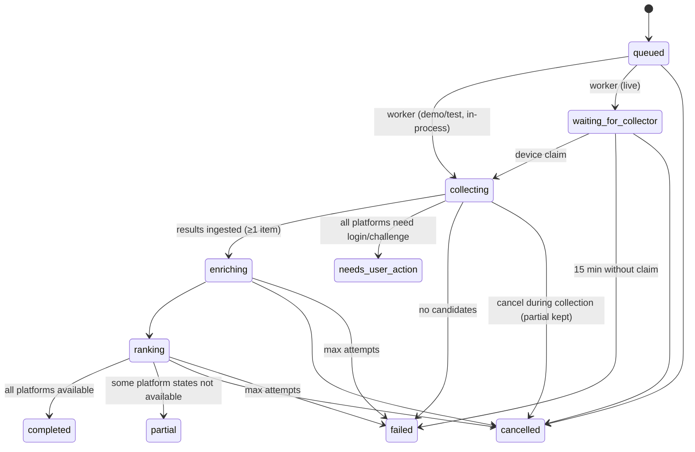

# Technical design

## Decisions and trade-offs

| Area | Decision | Alternatives considered | Why |
|---|---|---|---|
| Queue | PostgreSQL table + `FOR UPDATE SKIP LOCKED` leases | Redis/arq, Celery, procrastinate | Jobs already need persisted leases/heartbeats/checkpoints for the collector protocol; one datastore means one backup, transactional state transitions and no Redis on a Windows dev box. Throughput needs are tiny (one user, a few jobs/day). |
| Auth | Password (Argon2id) + opaque server-side sessions; cookie+CSRF (web), bearer (mobile) | Self-hosted OIDC (Keycloak/Authentik), JWTs | Fewer moving parts for a self-hosted graduation project; no custom crypto or token format; revocation is a row update. OIDC remains possible later (same `AuthSession` table). Recovery is admin-driven (no email service). |
| ORM/sessions | Synchronous SQLAlchemy 2.0 + psycopg3 | Async SQLAlchemy | Simpler correctness with `SKIP LOCKED`, threadpool endpoints are fine at this scale. |
| Embeddings | JSON vectors + in-Python cosine over ≤ 200 candidates per job | pgvector | pgvector needs a server extension (not present on the dev host); per-job candidate sets are small. Documented upgrade path: swap `ItemEmbedding.vector` to `vector(dim)` and index. |
| Browser engine | Playwright (Python) with persistent profiles | agent-browser, browser-use | Deterministic scripted scrolling, request routing (allowlist/media block), fixture-testable extraction, no LLM in the browsing loop. |
| Model runtime | Ollama via HTTP, structured output with JSON schema | llama.cpp bindings, paid APIs | Already the user's default; capability discovery via `/api/show`; paid providers disabled by default. |
| Web ↔ API | Next.js rewrite `/api/*` → backend | CORS + cross-site cookies | First-party cookie keeps `SameSite=Lax` + HttpOnly simple and CSRF-defensible. |
| Mobile transport | Bearer token in SecureStore | Cookies | Native apps have no ambient cookie jar across origins; SecureStore = Keychain/Keystore. |

## API (v1)

All routes under `/api/v1`. Errors use `{"error": {"code", "message", "request_id", "details?"}}`.
Pagination is cursor-based (`next_cursor`), ordered by `(created_at desc, id desc)`.

| Group | Routes |
|---|---|
| auth | `POST /auth/register`, `POST /auth/login`, `POST /auth/logout`, `GET /auth/sessions`, `DELETE /auth/sessions/{id}` |
| me / preferences | `GET /me`, `GET/PUT /preferences`, `POST /preferences/complete-onboarding` |
| platforms / connections | `GET /platforms`, `GET /connections`, `PUT /connections/{platform}`, `DELETE /connections/{id}` |
| collectors | `POST /collectors/enrollments` (user), `POST /collectors/enrollments/exchange` (code → device credential), `GET /collectors`, `DELETE /collectors/{id}`, `POST /collectors/heartbeat` (device) |
| collector jobs (device) | `POST /collector/jobs/claim`, `POST /collector/jobs/{id}/lease`, `POST /collector/jobs/{id}/events`, `POST /collector/jobs/{id}/results`, `GET /collector/jobs/{id}/cancel-requested` |
| jobs | `POST /jobs` (202), `GET /jobs`, `GET /jobs/{id}?since_seq=`, `POST /jobs/{id}/cancel` |
| batches | `GET /batches/today`, `GET /batches`, `GET /batches/{id}`, `POST /batches/{id}/complete`, `POST /batches/{id}/recommendations/{rec}/seen` |
| search | `POST /search` (202, job reference) |
| items | `GET /items/{id}` (authorized by observation/recommendation/saved) |
| saved / feedback | `GET/POST /saved`, `DELETE /saved/{item_id}`, `GET/POST /feedback`, `DELETE /feedback/{id}` |
| schedules | `GET/POST /schedules`, `PUT/DELETE /schedules/{id}` |
| models | `GET /models`, `GET /capabilities` |
| privacy | `GET /privacy/export`, `POST /privacy/delete` |
| health | `GET /health/live`, `GET /health/ready` |

Progress mechanism: authenticated polling of `GET /jobs/{id}` with `since_seq` (events are
append-only with a per-job sequence), client backoff on failure (1 s → 10 s).

Idempotency: `POST /jobs`/`/search` accept `idempotency_key` (unique per user) and otherwise derive
one from `(user, mode, query, platforms, 2-minute bucket)`; identical requests return the same job
with `created=false`. Result submission carries `idempotency_key`; replays are acknowledged without
re-ingesting; a second distinct submission after the job moved on is `409`.

## Job state machine

Terminal: `completed`, `partial`, `needs_user_action`, `cancelled`, `failed`. Transitions are
validated in `services/jobs.py::transition`; every transition writes a `job_events` row.

### Budgets (enforced outside the model)

`ff_protocol.JobBudget` defaults: 40 candidates and 12 scroll steps per platform, 600 s wall clock,
120 s per stage, 60 model calls, 60 k input tokens, 10 media items, 4 frames per item, 50 MB
download, 600 s analysed media, 2 retries. Model calls are capped per job, embedding is one call per
batch, enrichment is limited to the 20 most plausible candidates, transcript text is cut at 6 000
chars per call. Longer per-call timeouts (`FF_MODEL_TIMEOUT_SECONDS`, default 180 s) suit heavier
local models; `provider_timeout` (deadline) is distinguished from `provider_unavailable`.

### Leases, heartbeats, recovery

Worker leases are renewed by a background thread every `lease/3` seconds; a lost lease sets the
cancel token. Device leases are renewed by the collector every 30 s and expose
`cancel_requested`. Stale leases are claimable after expiry; recovery is logged.

### Schedules

Stored as `(timezone, local_time, days_of_week)`; `next_run_at` is persisted in UTC and recomputed
with `zoneinfo` per day (DST-safe; non-existent local times resolve forward; ambiguous times use the
first occurrence). Due schedules create a job with idempotency key
`schedule:<id>:<next_run_at>`; an active job for the same schedule blocks a new one (no overlap).
Missed-run policy: `run_once` (catch up once) or `skip` (when > 23 h late). Disabled schedules or
revoked devices stop future work.

## Ranking

Pipeline (`focusfeed_api/pipeline`): `eligibility` → `dedup` → `enrich` → `scoring` → `diversity`
→ `explain`. Components and default weights (engineering heuristics, `FF_RANKING_WEIGHTS_JSON`):

| Component | Weight | Definition |
|---|---|---|
| intent_relevance | 0.35 | search: 0.7·keyword-match ratio + 0.3·embedding cosine; daily: = interest_match |
| interest_match | 0.25 | fraction of declared interests found in text/topics (whole-word) |
| feedback_signal | 0.10 | opt-in: 0.5 + 0.5·(pos−neg)/(pos+neg) over creators/topics marked relevant/not relevant (+ saved topics with consent) |
| freshness | 0.10 | exp decay, half-life 7 days; unknown → 0.4 |
| novelty | 0.10 | 1 if never recommended to this user before, else 0 |
| evidence_quality | 0.10 | metadata 0.25 · sampled frames 0.5 · transcript 0.6+0.3·coverage · combined 0.8+0.2·coverage |

Eligibility first: exclusions (whole-word), excluded/hidden creators, not-interested items, language
preference, explicit-intent `must_exclude` and `max_duration`. Dedup: `(platform, external_id)`,
canonical URL (tracking params stripped), identical normalized title on the same platform, and
semantic near-duplicate (cosine ≥ 0.97 **and** same creator). Diversity: per-platform MMR (λ=0.7,
creator repeat penalty), platform interleaving, then greedy consumption budget (unknown durations
use conservative per-platform defaults and are labelled). Persisted per recommendation: components,
rank, explanation, summary, topics, analysis kind, evidence ids, preferences version, config version.

## Local collector design

* `pair`: one-time code (16 chars, 10 min TTL, hashed server-side) → device credential (32 random
  bytes, hashed server-side, stored in the OS keyring; owner-only file fallback reported explicitly).
* `login <platform>`: opens the dedicated persistent Chromium profile headed; the user signs in.
* `run`: heartbeat (session statuses + capabilities) → claim → per-platform bounded collection with
  checkpoints and progress events → one idempotent results submission. Only `run` must stay open.
* Guards: `context.route` aborts requests outside the platform allowlist and all `media` resources;
  429 responses mark the result `rate_limited`; the profile is never the user's main browser profile.
* Policy: view/scroll/extract only; stops on login walls and challenges.
